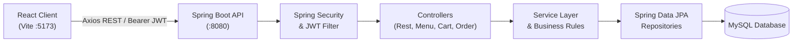

# ✨ Épicure — Online Food Ordering Service

> A full-stack, fine-dining food ordering platform built with **Spring Boot 4**, **Java 21**, **Spring Security (JWT)**, **MySQL**, and a chic editorial **React + Vite + Tailwind CSS** frontend.

---

## 🌟 Overview

**Épicure** is an end-to-end food ordering platform designed for both customers and culinary establishments. It pairs a robust enterprise Spring Boot backend with a responsive, luxury-editorial React client.

- **For Customers**: Browse curated restaurants, discover tasting menus, build carts with single-kitchen validation, checkout with real-time address validation, and track orders across their live lifecycle.
- **For Restaurant Owners**: Manage restaurant profiles, curate menus and seasonal dishes, and utilize a real-time kitchen expediting dashboard to advance orders through kitchen preparation and courier dispatch.

---

## 🛠️ Tech Stack

### Backend
- **Framework**: Spring Boot 4.x (Java 21)
- **Security**: Spring Security 6 with stateless JWT (`jjwt 0.12.6`), BCrypt password hashing, and Method Security (`@PreAuthorize`)
- **Persistence**: Spring Data JPA / Hibernate, MySQL 8+
- **Mapping & Utilities**: MapStruct 1.6, Lombok, Jakarta Validation
- **Testing**: JUnit 5, Mockito

### Frontend
- **Framework**: React 18 with Vite 6
- **Routing**: React Router v6
- **Styling**: Tailwind CSS v3, custom luxury color system (`ivory`, `espresso`, `champagne`), custom typography pairing
- **Icons**: Lucide React
- **HTTP Client**: Axios with Bearer token interceptor and global 401 handling

---

## 📐 Architecture & Data Flow



---

## 🚀 Key Features

### 1. Authentication & Role-Based Access Control
- JWT-based authentication with stateless session management.
- Multi-role authorization:
  - `CUSTOMER`: Browse tables, manage personal cart, checkout, cancel pending orders, view order history.
  - `RESTAURANT_OWNER`: Manage owned restaurants, menus, dishes, and advance kitchen orders.
  - `ADMIN`: Complete system access across all users, restaurants, and orders.
  - `DELIVERY_AGENT`: Delivery assignment integration readiness.

### 2. Curated Restaurant & Menu Catalog
- Public read access for guest visitors to explore restaurants, cities, and dishes before authenticating.
- Restaurant details with address, active status, and phone numbers.
- Menu hierarchies: Restaurant $\rightarrow$ Menus $\rightarrow$ Dishes/Items with prices, descriptions, and stock flags.

### 3. Smart Cart Functionality
- Persistent database-backed cart per user.
- **Single-Kitchen Integrity**: Ensures items in a cart come from one restaurant at a time, with a built-in switch-restaurant prompt if selecting dishes from another venue.
- Real-time subtotal and total calculations.

### 4. Order Management & Live Lifecycle
- Freezes prices and item names into immutable `OrderItem` snapshots at the moment of checkout.
- Automatically flushes and clears the active cart upon successful order placement.
- Supported order state lifecycle:
  $$\text{PENDING} \longrightarrow \text{CONFIRMED} \longrightarrow \text{PREPARING} \longrightarrow \text{READY\_FOR\_PICKUP} \longrightarrow \text{OUT\_FOR\_DELIVERY} \longrightarrow \text{DELIVERED}$$
  *(or $\text{CANCELLED}$ if revoked while still $\text{PENDING}$)*

### 5. Chic & Editorial User Experience
- Sophisticated serif typography featuring **Playfair Display** paired with **Plus Jakarta Sans**.
- Bespoke warm palette: warm alabaster (`#FAF8F5`), obsidian espresso (`#0C0B0A`), and champagne gold accents (`#CBB291`).
- Curated high-resolution imagery for Italian trattorias, craft burger shacks, and sushi ateliers.
- Slide-over bag drawer and concierge order folio receipts.

### 6. Automated Demo Data Seeder
- Includes [`DataInitializer.java`](file:///src/main/java/com/example/food/config/DataInitializer.java) which auto-populates realistic restaurants, menus, dishes, and demo credentials on a fresh database.

---

## 📡 REST API Reference

### 🔐 Authentication & Users (`/api/users`)
| Method | Endpoint | Access | Description |
| :--- | :--- | :--- | :--- |
| `POST` | `/api/users/register` | Public | Register a new user |
| `POST` | `/api/users/login` | Public | Sign in and receive JWT access token |
| `GET` | `/api/users/me` | Authenticated | Retrieve current user profile |
| `PUT` | `/api/users/me` | Authenticated | Update profile details |

### 🍽️ Restaurants (`/api/restaurants`)
| Method | Endpoint | Access | Description |
| :--- | :--- | :--- | :--- |
| `GET` | `/api/restaurants` | Public | List all active restaurants |
| `GET` | `/api/restaurants/{id}` | Public | Get restaurant details by ID |
| `POST` | `/api/restaurants` | `RESTAURANT_OWNER`, `ADMIN` | Create a new restaurant |
| `GET` | `/api/restaurants/my` | `RESTAURANT_OWNER`, `ADMIN` | List restaurants owned by current user |
| `PUT` | `/api/restaurants/{id}` | Owner / `ADMIN` | Update restaurant details |
| `DELETE` | `/api/restaurants/{id}` | Owner / `ADMIN` | Remove a restaurant |

### 📜 Menus & Dishes (`/api/menus`, `/api/menu-items`)
| Method | Endpoint | Access | Description |
| :--- | :--- | :--- | :--- |
| `GET` | `/api/restaurants/{id}/menus` | Public | Get all menus for a restaurant |
| `POST` | `/api/restaurants/{id}/menus` | Owner / `ADMIN` | Create a menu section |
| `GET` | `/api/menus/{id}` | Owner / `ADMIN` | Retrieve a specific menu |
| `GET` | `/api/menus/{menuId}/items` | Public | List all dishes in a menu |
| `POST` | `/api/menus/{menuId}/items` | Owner / `ADMIN` | Add a dish to a menu |
| `PUT` | `/api/menu-items/{id}` | Owner / `ADMIN` | Update dish price, name, or availability |
| `DELETE` | `/api/menu-items/{id}` | Owner / `ADMIN` | Remove a dish |

### 🛍️ Cart (`/api/cart`)
| Method | Endpoint | Access | Description |
| :--- | :--- | :--- | :--- |
| `GET` | `/api/cart` | Authenticated | View active cart |
| `POST` | `/api/cart/items` | Authenticated | Add item to cart (`menuItemId`, `quantity`) |
| `PUT` | `/api/cart/items/{itemId}` | Authenticated | Update item quantity |
| `DELETE` | `/api/cart/items/{itemId}` | Authenticated | Remove specific item |
| `DELETE` | `/api/cart` | Authenticated | Clear all items from cart |

### 📦 Orders (`/api/orders`)
| Method | Endpoint | Access | Description |
| :--- | :--- | :--- | :--- |
| `POST` | `/api/orders/checkout` | Authenticated | Convert active cart to an order snapshot |
| `GET` | `/api/orders/my` | Authenticated | Retrieve customer's order history |
| `GET` | `/api/orders/{id}` | Order Owner / Admin | Retrieve order details |
| `POST` | `/api/orders/{id}/cancel` | Order Owner | Cancel order (if still `PENDING`) |
| `GET` | `/api/orders/restaurant/{id}` | Restaurant Owner / Admin | View all incoming orders for kitchen |
| `PATCH` | `/api/orders/{id}/status` | Restaurant Owner / Admin | Advance order status (`PREPARING`, `DELIVERED`, etc.) |

---

## ⚙️ Getting Started

### Prerequisites
- **Java**: JDK 21 or newer
- **Node.js**: v18+ (Node 20+ recommended) & `npm`
- **Database**: MySQL 8.0+

---

### 1. Database Configuration
Create a database named `food_ordering_db` (or allow MySQL to auto-create it):
```sql
CREATE DATABASE IF NOT EXISTS food_ordering_db;
```

Verify or adjust connection details in `src/main/resources/application.properties`:
```properties
spring.datasource.url=jdbc:mysql://localhost:3306/food_ordering_db?createDatabaseIfNotExist=true&useSSL=false&allowPublicKeyRetrieval=true
spring.datasource.username=root
spring.datasource.password=root

jwt.secret=your_super_secret_jwt_key_that_is_at_least_256_bits_long
jwt.expiration=86400000
```

---

### 2. Run the Backend
From the root directory:

**Windows (PowerShell/CMD):**
```powershell
.\mvnw.cmd spring-boot:run
```

**macOS/Linux:**
```bash
./mvnw spring-boot:run
```

The backend starts at: **`http://localhost:8080`**  
*(On first startup, sample restaurants and demo users will be seeded automatically.)*

---

### 3. Run the Frontend
In a separate terminal, navigate into `frontend`:
```bash
cd frontend
npm install
npm run dev
```

Open your browser at: **`http://localhost:5173`**

---

## 👥 Seeded Demonstration Accounts

When the database is newly initialized, you can log in immediately with:

| Role | Email | Password | Access Capabilities |
| :--- | :--- | :--- | :--- |
| **Customer** | `customer@example.com` | `password123` | Browsing, ordering, cart, order tracking |
| **Restaurant Owner** | `owner@example.com` | `password123` | Managing restaurants, menus, kitchen expediter |
| **System Admin** | `admin@example.com` | `admin123` | Complete platform administrative access |

---

## 🧪 Running Tests

To run the backend unit tests:
```powershell
.\mvnw.cmd test -Dtest=OrderServiceTest
```

To build a production bundle of the React client:
```powershell
cd frontend
npm run build
```

---

## 📂 Project Structure

```
Online-Food-Ordering-Service/
├── frontend/                     # React + Vite Client
│   ├── src/
│   │   ├── api/client.js         # Axios client & API service layer
│   │   ├── components/           # Navbar, CartDrawer, UI components
│   │   ├── context/              # AuthContext & CartContext
│   │   ├── pages/                # HomePage, RestaurantPage, OrdersPage, etc.
│   │   ├── App.jsx               # Routes & protected route configuration
│   │   └── main.jsx
│   ├── tailwind.config.js        # Luxury theme tokens (ivory, champagne, espresso)
│   └── vite.config.js            # Reverse proxy configuration to port 8080
│
├── src/main/java/com/example/food/
│   ├── config/                   # SecurityConfig (CORS/JWT), DataInitializer
│   ├── user/                     # Users, roles, JWT auth controller & service
│   ├── restaurant/               # Restaurants catalog entity, service, controller
│   ├── menu/                     # Menus hierarchy entity, service, controller
│   ├── menuitem/                 # Dishes entity, repository, service, controller
│   ├── cart/                     # Cart & CartItem persistence, service, controller
│   ├── order/                    # Order & OrderItem lifecycle, checkout, controller
│   ├── security/                 # Custom UserDetailsService, JWT Filter & Security beans
│   └── exception/                # GlobalExceptionHandler & ErrorResponse
│
├── src/main/resources/
│   └── application.properties    # Database, JPA, and JWT configurations
├── pom.xml                       # Maven build specification
└── README.md
```

---

## 📄 License
This project is open-source and available under the [MIT License](LICENSE).

